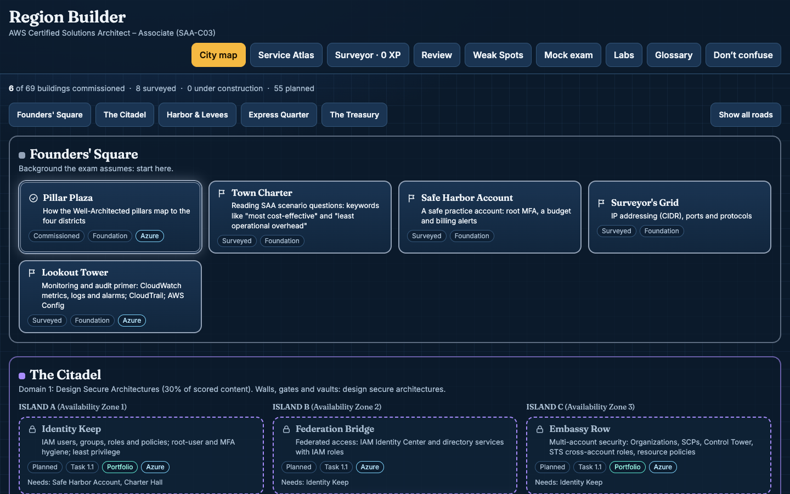
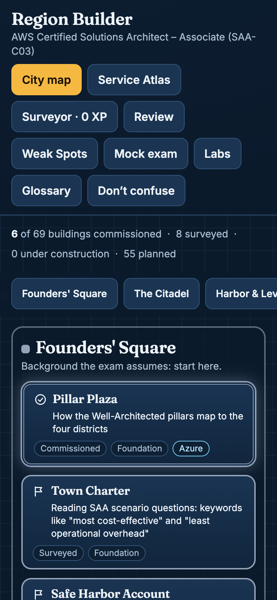
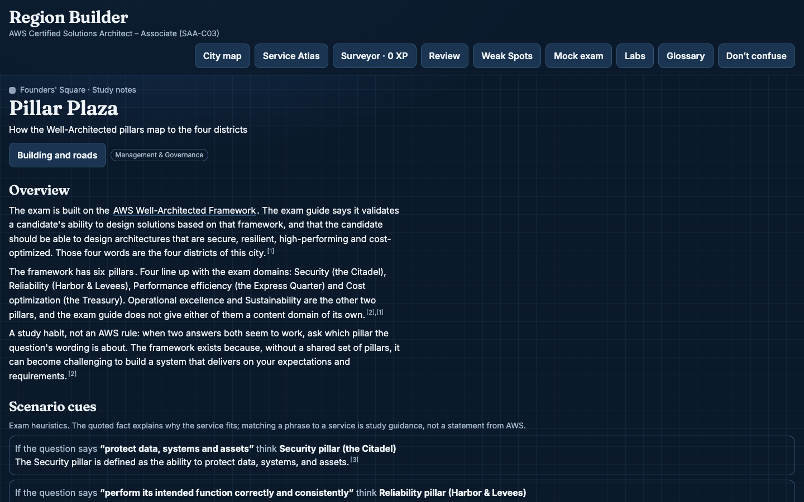
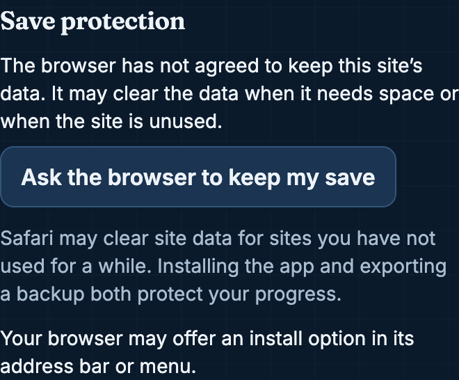
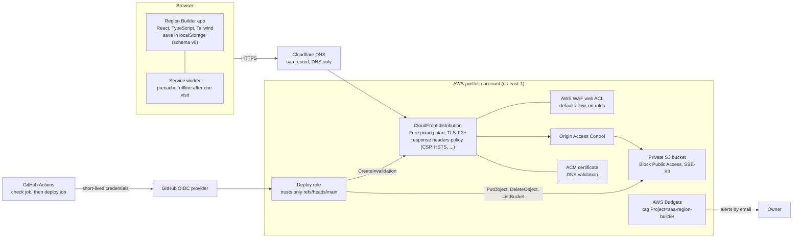

# Region Builder: AWS Certified Solutions Architect – Associate (SAA-C03)

A study game in which you are the chief architect building a city inside an AWS Region. The Region has three islands
(Availability Zones) and four districts, one for each exam domain. You survey buildings, pass start-up checks, sit
inspections, and commission each building when you can answer its questions. Along the way you run hands-on labs in a
real AWS account, solve practice puzzles, and sit mock exams.

It is an unofficial study aid. It is not affiliated with, endorsed by, or sponsored by Amazon Web Services, Inc. See
[Attribution](#attribution-and-disclaimer).

- Live site: `https://edwardtorres.dev/apps/region-builder/`
- Deployment and operations: [DEPLOY.md](DEPLOY.md)
- Step audits, decisions and reviews: [docs/](docs/)

## Screenshots

| 1440 px (desktop) | 390 px (phone) |
| --- | --- |
|  |  |
|  |  |

The screenshots show a seeded save and are captured from the production build by `npm run screenshots`.

## What is in it

- **Outline coverage.** 4 domains, 14 task statements, 189 outline bullets (checked against the live exam guide), 69 buildings,
  97 roads (prerequisites), and 1,013 questions. Multiple choice and multiple response only, weighted 30/26/24/20.
- **Notes for every building,** with "don't confuse" pairs, a glossary, Azure crosswalk notes where Microsoft Learn compares a
  service, and every claim cited to an AWS documentation page with a verbatim quote that is checked against the live page.
- **Game loop.** Start-up checks, five-question inspections, placement checks for the portfolio buildings, XP, ranks,
  streaks, badges and per-domain readiness. Full credit only: a multiple-response question is right only when exactly the
  keyed set is chosen.
- **Puzzles.** Seven practice types with computed answers, including an IAM policy evaluator, a VPC traffic tracer, an S3
  lifecycle planner and an architecture builder. Each rule carries an AWS quote, and an evaluator refuses any scenario its
  rules do not settle.
- **Labs.** Fourteen hands-on labs for a dedicated account, with CloudFormation templates, cleanup checklists and cost
  guardrails. The labs state no prices. A Free-plan badge is derived from a dated snapshot of the AWS Free Tier page.
- **Review and mock exams.** Spaced daily review, a maintenance set for buildings that fall behind, Weak Spots, and 65-question
  mock exams weighted 19/17/16/13 with the scoring note that a raw percentage cannot predict a scaled score.
- **Privacy by design.** Progress lives in the browser's local storage, under a versioned save schema with migrations. There
  is no account, no analytics and no backend. The app can export and import a save file, and it works offline after one visit.

## How the content is built

Every note, question, puzzle and lab went through the same loop:

1. **Plan.** Per-building targets and writer rules (`docs/question-plan.json`, `docs/question-writing-guide.md`,
   `docs/puzzle-writing-guide.md`, `docs/lab-writing-guide.md`).
2. **Build.** Writer agents drafted each district's content from AWS documentation only, and the checks in `scripts/` ran on
   every draft.
3. **Blind review.** A separate reviewer answered the questions from a keyless export (`scripts/export-blind.ts`), and
   `scripts/score-blind.ts` compared the answers with the keys. A disagreement is a dispute to resolve, not a result to
   average.
4. **Source review.** A second reviewer checked each key and explanation against the page it cites.
5. **Fact-check.** Every cited claim was audited against AWS documentation, with an adjudication gate (`docs/step-8-audit.md`):
   a wrong answer key or a false claim counts against a 3% error limit, and every claim that the quote does not state directly is
   reworded or given a verbatim quote that does.
6. **Audit.** Each step ends with an audit that the owner reviews before the next step starts (`docs/step-*-audit.md`).

Where AWS pages disagree, both readings are recorded in `content/contradictions.json`. A claim that cannot be verified goes to
`content/needs-verification.json` and stays out of the notes and questions. Features newer than the exam guide are tagged
in a registry (`content/post-guide.json`), and a newer feature is never the key when the established design is a wrong option.

## Architecture



- The app is a static build: Vite, React 19, TypeScript in strict mode, Tailwind v4. The question data is code-split by
  district and by feature, so the first load is only the map.
- The security headers are defined once (`scripts/lib/securityHeaders.ts`) and used by the Vite build, by the local production
  server that e2e and Lighthouse run against, and by the CloudFront response headers policy. A unit test keeps the template and
  the shared values equal.
- The infrastructure is two CloudFormation stacks in `infra/`: a certificate stack, and a site stack with the bucket, OAC,
  web ACL, distribution, response headers policy, GitHub OIDC provider, deploy role and budget. No account ID, ARN or secret is
  committed; values are supplied at deploy time.

## Checks and tests

| Command | What it proves |
| --- | --- |
| `npm run check` | Typecheck, lint, unit tests, content and outline checks, CloudFormation templates (cfn-lint), production build, bundle (no dev hooks, no external origins, strict CSP), and hygiene (no private links, tokens, account IDs or local paths in files or commits) |
| `npm run test:layout` | At 390 px (touch) and 1280 px (keyboard): no sideways scroll, targets of at least 44 px, panels and saves work |
| `npm run e2e` | Playwright against the production build at 1440 px and 390 px, with axe (serious and critical issues fail): the building flow, placement, reviews, puzzles, labs, the mock, headers and CSP, the service worker offline, the not-found page |
| `npm run check:links` | Every cited URL answers, every anchor exists, and every quote appears verbatim on its page |
| `npm run check:freshness`, `check:content -- --live`, `check:freeplan` | Network checks against the live AWS pages, the exam guide and the Free Tier page |
| `npm run lighthouse` | Lighthouse's mobile preset on the production build (scores recorded in `docs/lighthouse/`) |

The full unit suite runs with Vitest (a Node project and a DOM project). The weekly content watch runs the three network checks
on a schedule and opens an issue only when they find something new.

## Running it locally

```bash
npm ci
npm run dev                 # development server, with dev-only hooks
npm run build && npm run preview
npm run check               # everything that runs offline
```

Node 22 is used in CI. The end-to-end tests use a local Chromium; set `CHROMIUM_PATH` to point at a browser binary if needed.

## Deployment and upkeep

The public portfolio uses Cloudflare Pages at `/apps/region-builder/`. Build with `npm run build:site`, then run
`npm run copy:site -- <portfolio checkout>`. Commit the scoped app files together with the portfolio's `_headers` rules and
push its `main` branch. The manifest, worker, icons, assets and 404 links all use the app path; the worker cannot control the
portfolio or the other study apps. The copy step retains previous hashed assets for tabs open during an update.
See [DEPLOY.md](DEPLOY.md) for the public deployment and the optional separate AWS hosting setup.

- **Deploy.** Every push to `main` runs the check job (the same checks, plus the end-to-end suite on the production build). If it
  passes, the deploy job publishes the exact bytes it tested to S3 and invalidates CloudFront. A smoke run then tests the live
  site and reports without blocking. [DEPLOY.md](DEPLOY.md) has the setup order and the rollback procedure.
- **Staying current.** A weekly workflow re-checks the cited AWS pages, the live exam guide and the Free Tier offers. It opens
  one issue labelled `content-freshness` when something changes, and comments only when the findings differ from the report that
  issue holds.

## Repository layout

| Path | Contents |
| --- | --- |
| `content/` | Sources, notes per district, question bank, puzzle scenarios, labs and their templates, glossary, the verification queues |
| `src/` | The app: data, game engine, save schema and migrations, puzzles, labs, review and mock draws, UI |
| `scripts/` | Content checks, link and freshness checks, bundle and hygiene checks, the layout test, the Lighthouse runner, screenshots, the production server, the watch |
| `e2e/` | Playwright specs for the production build and the live site |
| `infra/` | The CloudFormation stacks for the site |
| `.github/workflows/` | The deploy workflow and the weekly content watch |
| `docs/` | Step audits, reviews, writing guides, Lighthouse results and screenshots |

## Attribution and disclaimer

- This is an **unofficial study aid** made by an individual. It is **not affiliated with, endorsed by, or sponsored by Amazon Web
  Services, Inc.** or Amazon.com, Inc. "AWS", "Amazon", and the names of AWS services are trademarks of their owners.
- The notes and questions are written from **AWS documentation** (docs.aws.amazon.com and aws.amazon.com) and cite the pages they
  use. The exam domains, task statements and bullets follow the **AWS Certified Solutions Architect – Associate (SAA-C03) exam
  guide**. The Azure comparison notes cite **Microsoft Learn** comparison pages. Microsoft and Azure are trademarks of Microsoft
  Corporation.
- Exam questions here are original practice questions. They are not AWS exam questions, and no exam dump was used.
- Nothing here guarantees a result on the exam. Use the official AWS practice question set and practice exam before you book.
